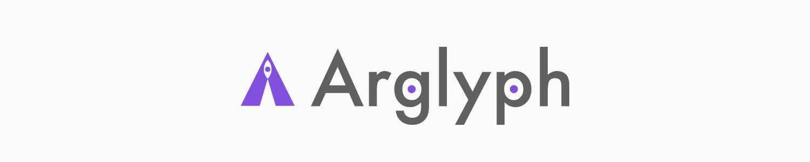
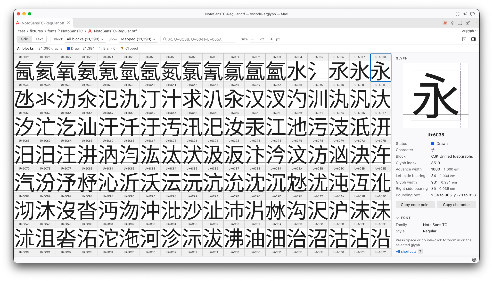
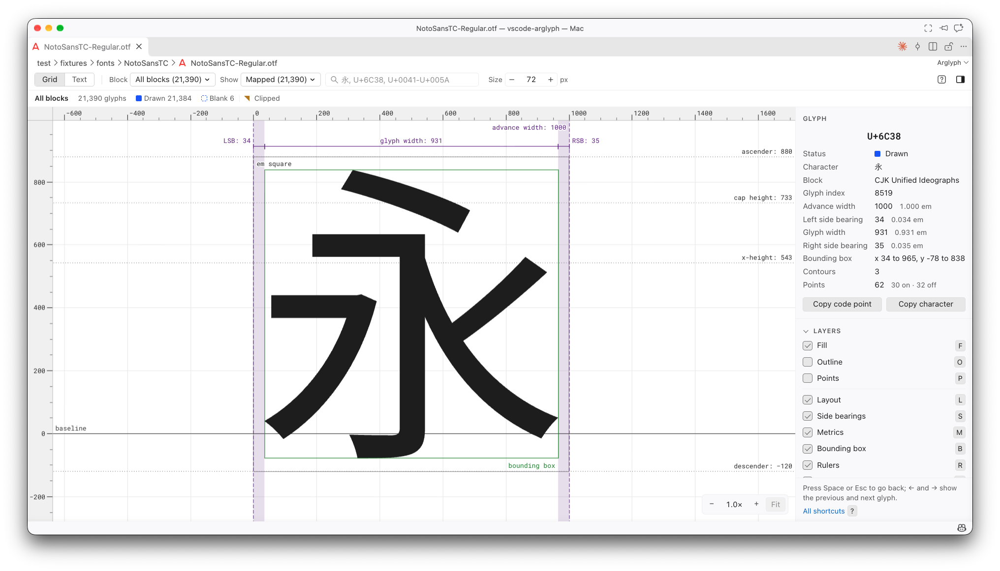
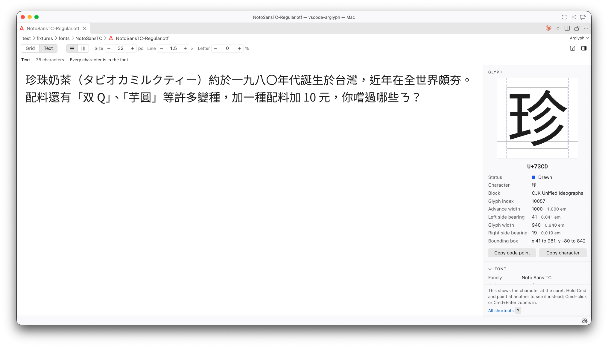
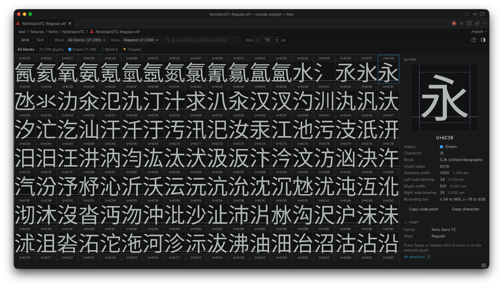

<div align="center">



<h1 align="center">Arglyph: CJK Font Viewer for VS Code</h1>

[](https://github.com/wangwenho/Arglyph/releases)
[](https://marketplace.visualstudio.com/items?itemName=wangwenho.arglyph)
[](LICENSE)

</div>

Browse every glyph of a CJK font in a smooth grid, zoom in to its outlines and control points, and preview your own text in it, all inside VS Code.

## Features

- **Grid**: see every glyph at once, smooth even with tens of thousands, and spot the ones the font lacks.
- **Zoom**: inspect any glyph down to its outlines, control points, metrics and side bearings.
- **Text**: preview your own text in the font without installing it.

## Views

### Grid



Filter by Unicode block, or search by character, code point or range. Every cell shows the state of its glyph: drawn, blank (such as a space), undrawn (an empty glyph where Unicode expects ink) or missing (not in the font).

> **Shortcuts:** `Space` or double-click to zoom in · `Cmd/Ctrl`+`F` to search · `Cmd/Ctrl`+`+` / `−` to resize glyphs · `?` for every shortcut

### Zoom



Nine layers you can toggle: fill, outline, points and handles, layout, side bearings, metrics, bounding box, rulers and grid. Every line is labeled on the canvas with its value in font units.

> **Shortcuts:** Scroll to zoom · drag to pan · `F` `O` `P` `L` `S` `M` `B` `R` `G` to toggle the layers, in the order above

### Text



Write horizontally or vertically, with adjustable line height and letter spacing. A character the font lacks is marked as missing.

> **Shortcuts:** Hold `Cmd/Ctrl` and point at a character to inspect it · `Cmd/Ctrl`+`Enter` to zoom in on it

### Theme



Arglyph follows your VS Code theme (light, dark or high contrast) and adjusts glyph colors so they stay readable.

## Installation

1. Install **Arglyph** from the [Marketplace](https://marketplace.visualstudio.com/items?itemName=wangwenho.arglyph), or run `ext install wangwenho.arglyph` in Quick Open (`Cmd/Ctrl`+`P`).
2. Click a `.ttf` or `.otf` file in the Explorer, or run **Arglyph: Open Font…** from the Command Palette. The font reloads whenever the file changes on disk.
3. If another extension also opens font files, right-click the tab → **Reopen Editor With…** → **Arglyph**, or make Arglyph the default in your `settings.json`:

   ```json
   "workbench.editorAssociations": {
     "*.ttf": "wangwenho.arglyph",
     "*.otf": "wangwenho.arglyph"
   }
   ```

## Limitations

- Only `.ttf` and `.otf` files are supported.
- Variable fonts appear at their default instance; their axes can't be adjusted yet.
- Fonts are read-only: Arglyph never edits them.

## Development

```bash
pnpm install
pnpm fetch:fixtures   # the test fonts
pnpm dev              # the app in a browser tab
pnpm test             # unit tests
pnpm e2e              # end-to-end checks in headless Chromium
pnpm package          # build the .vsix
```

`pnpm lint` and `pnpm typecheck` run the other checks. Press `F5` in VS Code to run the extension in a development host with the test fonts in the Explorer. Bugs and ideas are welcome in the [issues](https://github.com/wangwenho/Arglyph/issues).

## Acknowledgements

### Dependencies

- [opentype.js](https://github.com/opentypejs/opentype.js): parses the font files.
- [Unicode 18.0.0](https://www.unicode.org/versions/Unicode18.0.0/): the blocks, categories and coverage behind the grid.
- [Noto Sans TC](https://fonts.google.com/noto/specimen/Noto+Sans+TC), [Noto Serif TC](https://fonts.google.com/noto/specimen/Noto+Serif+TC) and [Lato](https://fonts.google.com/specimen/Lato) (SIL OFL 1.1): the fonts the tests run on.

### References

- [How to make a font](https://www.makingsoftware.com/chapters/how-to-make-a-font), Dan Hollick, Making Software: what a font file contains, from outlines and metrics to hinting.
- [Curves and Surfaces](https://ciechanow.ski/curves-and-surfaces/), Bartosz Ciechanowski: how Bézier curves and their control points work, with interactive demos.
- [下載字型前先看｜為什麼會缺字？](https://blog.justfont.com/2023/06/charactersets/), justfont blog: why a CJK font can lack characters, from encoding problems to limited character sets.

## Name

Arglyph is Argus plus glyph. Argus Panoptes is the hundred-eyed giant of Greek myth who saw everything.

## License

[MIT](LICENSE). Third-party licenses are in [THIRD_PARTY_NOTICES](THIRD_PARTY_NOTICES).
